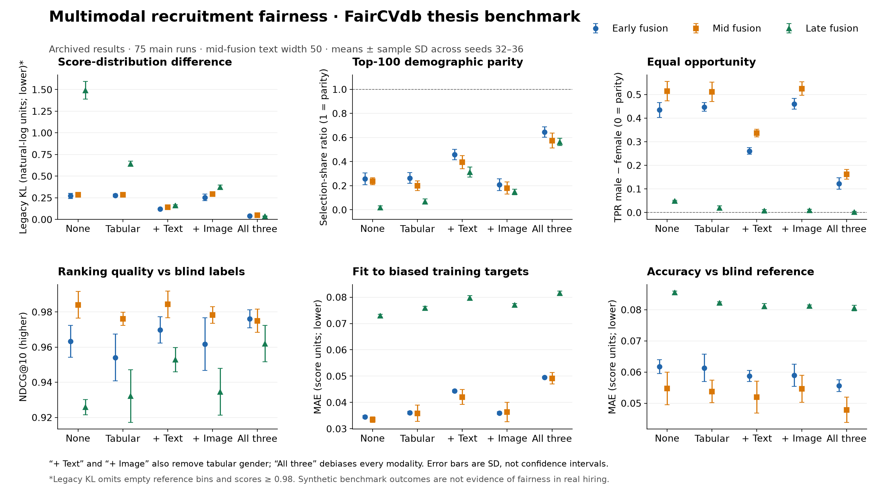

# Multimodal Recruitment Fairness

**Bachelor’s thesis · Amine Mohamed Zarouali · Vrije Universiteit Brussel · August 2026**

How much does removing gender information from text, images and tabular features change the fairness of a multimodal recruitment model?

This project benchmarks **early, mid and late fusion in PyTorch** on FairCVdb, comparing five debiasing conditions over five random seeds: **75 main experimental runs**. It evaluates fairness alongside ranking quality and prediction error, rather than relying on a single fairness score.



## What I implemented

- Early-fusion, mid-fusion and late-fusion neural models, with shared training and evaluation helpers.
- A controlled comparison of original and debiased tabular, text and image representations.
- Input and internal-representation probes to examine how much gender information remains recoverable.
- Experiment-level result archives and analysis of the fairness–performance trade-off.

FairCVdb, its debiasing transformations and provided face embeddings come from prior work. Text features use frozen BERT embeddings. This repository contains the thesis implementation and analysis, **not the original FairCVtest framework**.

## Main findings

- Adding text debiasing to tabular gender removal gave the strongest additional fairness improvement across all three fusion strategies.
- Debiasing all modalities produced the best overall fairness pattern in this benchmark.
- Error against biased training targets generally increased, while error against blind reference scores decreased or changed little.

A small equal-opportunity gap alone is not proof of a fair model: it can coexist with poor demographic parity or very few selected candidates. The results concern a controlled benchmark, not real-world hiring outcomes.

## Explore the code

| Component | Location |
|---|---|
| Fusion models and experiment loops | [`notebooks/`](notebooks/) |
| BERT extraction and input/label probes | [`notebooks/prep/`](notebooks/prep/) |
| Internal-representation probes | [`notebooks/probe_internal.ipynb`](notebooks/probe_internal.ipynb) |
| Archived experiment-level metrics | [`results/`](results/) |
| Static results image and summary statistics | [`assets/`](assets/) |

## Reproduce the results image

No dataset is needed to recreate the figure from the archived metrics. The checked publication environment uses Python 3.11.

```bash
python -m venv .venv
source .venv/bin/activate
python -m pip install -r requirements-tested.txt
python scripts/make_overview.py
python -m unittest discover -s tests -v
```

Error bars show **sample standard deviations across five seeds**, not confidence intervals. The chart script validates the main 75-run matrix before generating the image and summary CSV. The visualization and publication tests were added for this release; they are not represented as original thesis code.

## Verification and limitations

**Five publication-focused tests pass**, covering notebook validation, model forward paths, helper metrics, synthetic-fixture loading, a bounded CPU training smoke test and deterministic chart generation. The full 75 experiments were **not rerun** for publication; the chart uses the archived thesis results.

FairCVdb is a synthetic résumé benchmark with real-person-derived biography and face sources. No datasets, candidate profiles, embeddings, model weights or private notebook outputs are distributed. The benchmark uses binary gender labels and does not establish intersectional or real-world hiring fairness.

For full reproduction instructions, historical metric conventions and edge cases, see [experiment details](docs/EXPERIMENTS.md). See also [verification evidence](docs/VERIFICATION.md) and [result provenance](docs/PROVENANCE.md).

## Attribution

*Benchmarking Bias and Fairness in Multimodal AI Recruitment*, bachelor’s thesis by Amine Mohamed Zarouali, VUB, August 2026. Supervisor: Prof. dr. Lynn Houthuys. Advisor: Farnaz Faramarzi Lighvan.

Based on [BiDAlab’s FairCVtest/FairCVdb](https://github.com/BiDAlab/FairCVtest), with attribution to Peña et al., SensitiveNets and Bias in Bios. See [publication permission and prior-work attribution](docs/RIGHTS.md) and [citation details](docs/EXPERIMENTS.md#citation).

The author authorized publication of his contributions. No blanket open-source license or dataset redistribution permission is granted.
